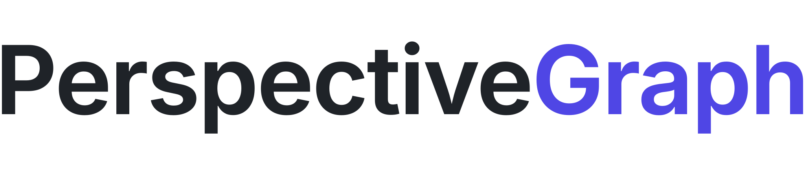
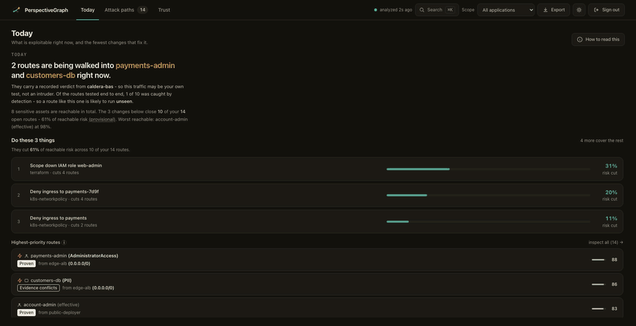

<h1 align="center">
  
  <picture>
    <source media="(prefers-color-scheme: dark)" srcset="docs/wordmark-dark.svg">
    
  </picture>
</h1>

<p align="center"><strong>Your scanners find issues. This finds the way in.</strong></p>

<p align="center">
  <a href="https://github.com/luiacuaniello/perspectivegraph/actions/workflows/ci.yml"></a>
  <a href="https://github.com/luiacuaniello/perspectivegraph/releases"></a>
  <a href="LICENSE"></a>
  <a href="https://scorecard.dev/viewer/?uri=github.com/luiacuaniello/perspectivegraph"></a>
  <a href="https://www.bestpractices.dev/projects/13828"></a>
  <a href="backend/go.mod"></a>
  <a href="https://demo.a3thinker.it"></a>
</p>

PerspectiveGraph finds the routes an attacker could follow from the internet, through
permissions that are too broad, to your sensitive data. It builds them from what you already
have, the output of Trivy, Semgrep, Cloud Custodian and Falco plus your AWS accounts and
Kubernetes clusters, then shows every hop of each route and writes the change that closes it.
In a pull request, the check fails only when that change opens a route or makes one easier.

Say a scanner reports a critical CVE in a container. It is one finding among thousands, and
nothing in the report says it matters more than the rest. PerspectiveGraph sees that the
container sits behind a public load balancer and runs with a role that can read the production
database, so that finding goes to the top of this week's list.

It is open source (Apache 2.0), runs on your infrastructure and sends no telemetry.



*`make demo`, on sample scanner output and seeded verdicts rather than a real environment.*

## Try it

The [public demo](https://demo.a3thinker.it) is the same dashboard, read-only, on sample data.
There is nothing to install.

To run it yourself, clone the repository. You need Docker, `jq` and `curl`:

```bash
make demo
```

This pulls the published, signed images, loads sample output from the scanners and the cloud,
and prints the top attack path with its fix. The dashboard is at http://localhost:3000, and
`make down` removes everything. The demo has no authentication, so keep it on your machine.

## Check your own account in 30 seconds

You don't need to deploy anything for this. A single binary asks AWS's own policy evaluator
which of your roles can end up as administrator, taking into account the service control
policies, permission boundaries and condition keys that reading the policies alone would miss:

```bash
# macOS on Apple silicon; for other systems use linux_amd64, linux_arm64 or darwin_amd64
curl -sSL https://github.com/luiacuaniello/perspectivegraph/releases/latest/download/perspectivegraph_darwin_arm64.tar.gz | tar xz
./perspectivegraph redteam -roles -region eu-west-1
```

Each check is an `iam:SimulatePrincipalPolicy` dry run, so it changes nothing and costs
nothing. The only permissions it needs are that one and `iam:ListRoles`, both in
`SecurityAudit`. Windows builds are on the
[releases page](https://github.com/luiacuaniello/perspectivegraph/releases/latest). Every binary
is signed with cosign and has SLSA provenance, and
[two commands verify them](SECURITY.md#our-own-supply-chain) before you run anything.

Add `-compare` and it also runs the engine on the same account, exiting non-zero wherever the
two disagree. That is how the engine's
[first real false positive](docs/manual/accuracy.md#the-engines-first-demonstrated-false-positive---found-then-closed)
was found and fixed. If they disagree on your account,
[please report it](https://github.com/luiacuaniello/perspectivegraph/issues/new?template=engine-vs-aws.yml).
To go further on your own estate, [evaluating PerspectiveGraph](docs/EVALUATION.md) works
through it in stages that each end with an answer.

## Fail the pull request that opens a route

The GitHub Action reads your AWS account (read-only), adds the scan from the pull request and
asks the same question. Nothing needs to be deployed:

```yaml
- uses: luiacuaniello/perspectivegraph@v1
  with:
    mode: local
    aws-region: eu-west-1     # read-only; give the job an OIDC role with SecurityAudit
    report: trivy.json
```

A critical CVE on a host that nothing routes to doesn't fail the build. A medium one on a
container that can now reach the production database does. Routes that were already there,
and that the change leaves as they were, don't count. When the scan never arrived, the result is
`unknown` (exit 2) instead of a green tick; `clean` exits 0 and `blocked` exits 1.

The same gate checks Terraform plans (`terraform show -json`) before they are applied, runs as a
CLI in any other CI (`perspectivegraph gate`) and installs as a Trivy plugin. The
[merge gate manual](docs/manual/ci-gate.md#the-merge-gate-github-action-cli-and-trivy-plugin)
covers every option.

> [!WARNING]
> Pull requests from forks get no secrets, so the gate fails closed as `unknown` on them. Don't
> work around it with `pull_request_target`: that runs your cloud credentials against the
> contributor's code. On a public repository a blocked check prints the route, with real asset
> names, in a public job log, so use `soft-fail` there and send the detail somewhere private.

## Install

On Kubernetes, the chart is an
[official package on Artifact Hub](https://artifacthub.io/packages/helm/perspectivegraph/perspectivegraph):

```bash
helm install perspectivegraph oci://ghcr.io/luiacuaniello/charts/perspectivegraph \
  --set secrets.generate=true \
  --version 1.41.0 # x-release-please-version
```

A default install requires authentication. `secrets.generate=true` creates the credentials and
keeps them across upgrades, and [the chart's page](deploy/helm/perspectivegraph/README.md#install)
lists the other choices.

On a single VM with Docker and a DNS name, `make prod-init DOMAIN=perspectivegraph.example.com`
sets up TLS, credentials, an authenticated message bus and daily backups
([production on one machine](docs/manual/single-vm.md)). From there,
[connect your own infrastructure](docs/manual/connect-your-own.md) points it at your AWS
accounts and clusters, and the [operations runbook](docs/OPERATIONS.md) covers what a real
rollout needs on top.

## Ask it from an AI agent

Ask a language model for the attack paths in your account and it will make up plausible ones.
With `perspectivegraph mcp` the agent asks the engine instead, over
[MCP](https://modelcontextprotocol.io):

```bash
perspectivegraph mcp --api https://demo.a3thinker.it   # the public demo needs no credentials
```

Every tool is read-only. The most useful one, `simulate_fix`, reruns the analysis with the edges
you want to cut and reports what really changes. The server is listed in the
[MCP Registry](https://registry.modelcontextprotocol.io), and the
[manual](docs/manual/ai-and-mcp.md#letting-an-agent-query-it-mcp) has the client setup.

## How much to trust it

The engine and its API are complete, documented and tested. The scores are not calibrated yet:
nobody has run it on a real estate, tested the routes it found and fed the results back. Read a
score as what the model concludes from the evidence it has. Use it to find and cut routes, and
don't put its percentage in front of a board. If you try it on yours,
[tell us how it went](https://github.com/luiacuaniello/perspectivegraph/discussions/286).

What is checked today:

- In CI, `make bench-cloudgoat` runs four
  [CloudGoat-style scenarios](backend/testdata/cloudgoat/README.md), two of which must produce
  no path. Precision and recall are 1.00 on all four. That makes it a regression gate; it says
  nothing about accuracy on your estate.
- On a real AWS account, a set of labs (`make redteam-aws`, `make reachability-lab-aws` and
  [the others](docs/manual/accuracy.md#the-labs-record-on-the-accuracy-page)) checks the
  engine's answers against what AWS actually does. They have caught real mistakes, a
  permissions boundary the engine ignored among them, and each one was fixed. The dashboard's
  Accuracy page lists every question with AWS's answer, the engine's and the version asked.
- AWS is live and verified. Azure runs on fixtures only, and there is no GCP or OpenStack
  connector yet; the [roadmap](ROADMAP.md#coverage) says what is planned.

Out of the box it opens no outbound connection: GitHub, the AI assistant and the KEV/EPSS feeds
stay off until you configure them. It is not a scanner, a CNAPP or a compliance product, and it
replaces none of them. [Positioning](docs/POSITIONING.md) lists what it claims and what it
doesn't.

PerspectiveGraph is written by a human working with Claude (Anthropic). The design decisions and
what ships are the maintainer's; much of the code and its tests came out of that collaboration.
So check it rather than trust it: `make test`, `make bench-cloudgoat`, `govulncheck ./...`, and
[CONTRIBUTING](CONTRIBUTING.md).

## Documentation

The manual is at [docs.a3thinker.it](https://docs.a3thinker.it), one page per subject, with
search. Good places to start:

- [Concepts in plain words](docs/manual/concepts.md): route, score, priority and the other words the dashboard uses
- [Evaluating PerspectiveGraph](docs/EVALUATION.md) on your own estate, in stages that each end with an answer
- [The manual's contents](docs/MANUAL.md): architecture, scoring, every integration, deployment
- [Operations](docs/OPERATIONS.md) · [Threat model](docs/THREAT-MODEL.md) · [Scale](docs/SCALE.md) · [API stability](docs/API-STABILITY.md) · [Upgrading](docs/UPGRADING.md)
- [Support](SUPPORT.md) · [Releases](RELEASES.md) · [Roadmap](ROADMAP.md) · [Security](SECURITY.md)
- [Contributing](CONTRIBUTING.md) · [Governance](GOVERNANCE.md) · [Maintainers](MAINTAINERS.md) · [Adopters](ADOPTERS.md)

## License

[Apache License 2.0](LICENSE). Every file declares its license in the form
[REUSE](https://reuse.software) defines, and CI checks it: [REUSE.toml](REUSE.toml).
